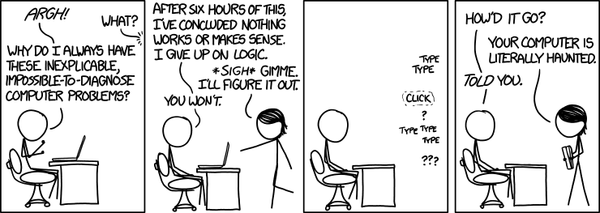
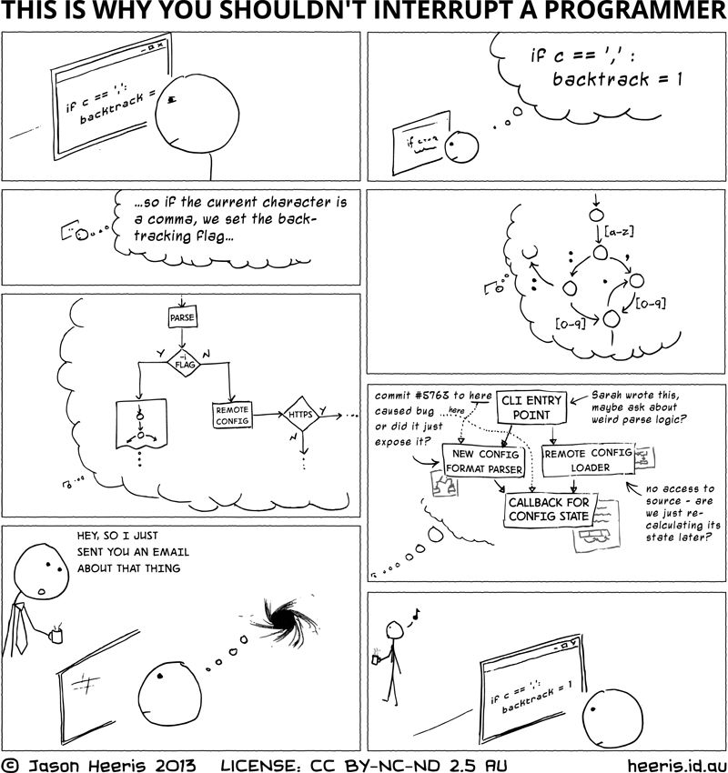

# StuckDev

**Streamlining peer-help among developers.**

A 2020 experiment in routing "I'm stuck" to the person who has seen it before, without wrecking that person's focus in the process.



## Why

Two observations from working on a team.

**1. The asymmetry of "I've seen this before."**

A junior can lose six hours to a problem a senior would spot in four seconds. Not because the senior is smarter, but because they hit the same wall two years ago. The bug isn't hard, it's just unfamiliar. Nearly all of those six hours are waste, and the only thing standing between the junior and the answer is that the right pair of eyes never looked at the screen.

**2. The cost of the shoulder tap.**

The obvious fix, "go ask someone", has a hidden price. When you're zoned in and someone taps your shoulder, the two minutes you spend answering aren't the real cost. The real cost is the twenty minutes afterwards spent rebuilding the mental stack you just lost. Do that a few times a day and the most experienced people on the team get the least deep work done.



So juniors learn not to ask, and go back to burning six hours. Everybody loses.

## The tension

These pull in opposite directions. Optimising for (1) alone means interrupt someone immediately, every time. Optimising for (2) alone means never interrupt anyone.

StuckDev's bet is that the shoulder tap is bad not because it asks for help, but because of *how* it asks:

| The shoulder tap | What we want instead |
| --- | --- |
| Targeted at one person | Offered to a group |
| Synchronous, demands attention *now* | Queued, waits until you surface |
| Socially expensive to refuse | One tap to pass, no explanation owed |
| You commit before knowing what it is | You see the problem before deciding |

Get those four right and asking for help stops costing anyone their afternoon.

## How it works

1. **Sign in** with GitHub or Google. No passwords to manage.
2. **Create a help group** and add the peers you'd actually interrupt: your team, your cohort, people who've agreed to be on the list.
3. **Get stuck.** File a request with a topic, some details, and which group to ask.
4. **The request is broadcast**, not directed. Every member of the group with push enabled gets a Web Push notification. Nobody is singled out, so nobody is on the hook.
5. **The notification waits.** It's fired with `requireInteraction: true`, so it sits there instead of disappearing. Finish your thought, then look. It carries two buttons: **View** and **Pass**.
6. **View shows a preview**, the topic and details, before you commit to anything. This is the "is this worth my context switch?" step.
7. **Whoever hits Connect first claims it.** Meanwhile the person who asked is parked on a waiting page that polls until a helper appears, then forwards them automatically.
8. **Both land in a Jitsi room**, with the asker's screen share already toggled on.

That last detail matters more than it looks. Juniors often can't *describe* a bug well enough to get help, because knowing which detail is the important one is exactly the expertise they're missing. Skipping the description and going straight to "here's my screen" removes the translation step entirely, which is the whole point of motivation (1).

When the call ends, the asker gets a follow-up page and the helper gets a thank-you page.

## Design notes

A few decisions that only make sense in light of motivation (2):

- **Groups are owner-curated.** You add people to your own group; there's no global pool. Help only flows between people who've opted into each other. It also keeps screen sharing inside a circle you trust. See the [Code of Conduct](app/views/home/code_of_conduct.html).
- **Push, not chat.** A chat message either pings you immediately or gets buried. A notification with `requireInteraction` is the only common primitive that persists without demanding an instant response.
- **First-claim-wins.** No assignment, no round-robin. Whoever has the least context to lose right now is the one who picks it up, and they self-select.
- **The Code of Conduct is part of the product**, not legal boilerplate. "Research it yourself first", "don't be a nagger", "be careful what you share on screen": these are the social norms that keep a low-friction ask channel from becoming a nuisance.

## Status: unfinished

This is an archived experiment, last worked on in April 2020. The happy path works end to end: sign in, group, request, notification, preview, connect, video, exit. What follows is missing, and it's worth being blunt that **the biggest gaps are in the machinery for motivation (2)**, which is the more interesting half of the idea.

**Built and working**
- OAuth sign-in, help groups, request creation
- Web Push fan-out to group members
- Notification, preview, claim, Jitsi session, with auto screen share
- Waiting page with availability polling and auto-forward

**Scoped but not built**
- **Pass does nothing.** `HelpRequestsController#pass_notification` returns `head :ok` and stops there. It doesn't record the pass, suppress re-notification, or inform routing. Since Pass is the helper's entire "not me, not now" mechanism, this is the most load-bearing stub in the repo.
- **No recirculation.** The follow-up page's "Nope, try someone else" button is an `href='#'`. A request that didn't get resolved has nowhere to go.
- **No availability state.** Nothing in the schema models "I'm in deep work, hold my notifications". A push still fires at the OS level regardless. Right now the Code of Conduct is doing that job socially instead of mechanically.
- **No topic matching.** `topic` is written into the notification body and never used again. The premise is that a *specific* person has seen this before, but there's no notion of who knows what.
- **No knowledge capture.** Nothing records what the fix turned out to be, so the next person to hit the same wall pays full price and the same helper gets interrupted again. A resolution note on the follow-up page would have been the cheap version of this.

**Known rough edges**
- The received-requests query in `HelpRequestsController#index` uses `"'?' = ANY (member_ids)"`, where the quoted `?` isn't a bind placeholder, so it almost certainly matches nothing.
- Redirect URLs in the service worker and `jitsi_init.js` are hardcoded to `http://`.
- The test suite is untouched Rails scaffolding and does not pass.
- Dependencies are from 2020 and have known advisories. Don't deploy this as-is.

## Stack

Rails 6.0 on Ruby 2.6.6, PostgreSQL, Puma. Webpacker 4 with React (via `react-rails`) for the request tabs, Tailwind 1.x, jQuery, Turbolinks. PWA and push via `serviceworker-rails` plus the `webpush` gem. Video through the Jitsi Meet external API against the public `meet.jit.si`. Deployment was Capistrano to a Passenger host.

## Running it locally

You'll need Ruby 2.6.6, PostgreSQL, and Yarn.

```bash
bundle install && yarn install
```

```bash
bin/rails db:create db:schema:load
```

`config/master.key` is not in the repo, so you'll need to create your own credentials file with the four secrets the app reads:

```bash
bin/rails credentials:edit
```

```yaml
google_oauth:
  client_id: your-google-client-id
  secret: your-google-secret
github_oauth:
  client_id: your-github-client-id
  secret: your-github-secret
vapid:
  public_key: your-vapid-public-key
  private_key: your-vapid-private-key
```

Generate the VAPID pair with `Webpush.generate_key` in a Rails console. Register the OAuth apps with a callback of `http://localhost:3000/auth/google_oauth2/callback` and `http://localhost:3000/auth/github/callback`.

```bash
bin/rails server
```

Push notifications need a secure context. `localhost` counts, so local development works, but anything else needs HTTPS. You'll want two browser profiles (or two machines) to try the full flow, since you need an asker and a helper.

## Credits

"This is why you shouldn't interrupt a programmer" is © [Jason Heeris](https://heeris.id.au/2013/this-is-why-you-shouldnt-interrupt-a-programmer/), 2013, used unmodified under [CC BY-NC-ND 2.5 AU](https://creativecommons.org/licenses/by-nc-nd/2.5/au/).

The two stick-figure comics are by Randall Munroe of [xkcd](https://xkcd.com), used under [CC BY-NC 2.5](https://creativecommons.org/licenses/by-nc/2.5/). The handwriting font is [xkcd-script](https://github.com/ipython/xkcd-font).
